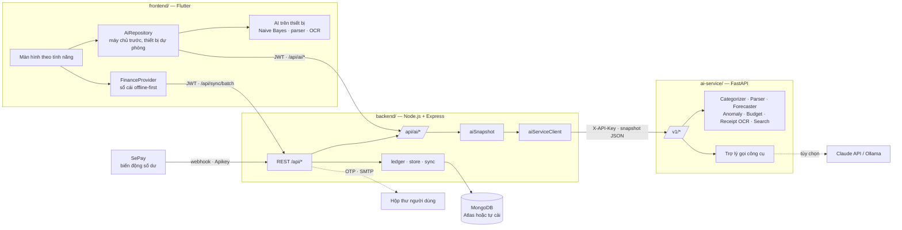

# 💰 LTD Financial App — Ứng dụng quản lý chi tiêu cá nhân tích hợp AI

> Đồ án học phần **Lập trình di động** (261IS26A01) — **Nhóm 03** — GVHD: ThS. Nguyễn Hoàng Anh

     

Ứng dụng di động giúp người dùng Việt Nam ghi chép thu chi, quản lý ví, vay/nợ, ngân sách và thống kê —
**hoạt động cả khi không có mạng**, đồng bộ lên máy chủ khi đăng nhập, và có một **dịch vụ AI riêng** để
hiểu câu tiếng Việt tự nhiên, dự báo chi tiêu, phát hiện giao dịch bất thường, đọc hóa đơn bằng OCR và trò chuyện như một trợ lý tài chính.

---

## Mục lục

1. [Tổng quan dự án](#1-tổng-quan-dự-án)
2. [Tính năng](#2-tính-năng)
3. [Kiến trúc hệ thống](#3-kiến-trúc-hệ-thống)
4. [Công nghệ sử dụng](#4-công-nghệ-sử-dụng)
5. [Cấu trúc thư mục](#5-cấu-trúc-thư-mục)
6. [Yêu cầu môi trường](#6-yêu-cầu-môi-trường)
7. [Cài đặt và chạy dự án](#7-cài-đặt-và-chạy-dự-án)
8. [Cấu hình (biến môi trường)](#8-cấu-hình-biến-môi-trường)
9. [Hướng dẫn sử dụng nhanh](#9-hướng-dẫn-sử-dụng-nhanh)
10. [API](#10-api)
11. [Trí tuệ nhân tạo và mô hình](#11-trí-tuệ-nhân-tạo-và-mô-hình)
12. [Kiểm thử](#12-kiểm-thử)
13. [Bảo mật và quyền riêng tư](#13-bảo-mật-và-quyền-riêng-tư)
14. [Xử lý sự cố thường gặp](#14-xử-lý-sự-cố-thường-gặp)
15. [Quy ước phát triển](#15-quy-ước-phát-triển)
16. [Hướng phát triển](#16-hướng-phát-triển)
17. [Thành viên và tài liệu](#17-thành-viên-và-tài-liệu)

---

## 1. Tổng quan dự án

### 1.1. Bài toán

Sinh viên và người đi làm thường chi tiêu nhỏ lẻ hằng ngày (ăn uống, đi lại, cà phê…), cho mượn/đi vay bạn bè,
nhưng ít khi ghi chép vì **nhập liệu mất công**, không biết **tiền đi đâu** và **cuối tháng còn bao nhiêu**.

### 1.2. Mục tiêu

- Ghi một giao dịch trong vài giây: gõ hoặc **nói** "ăn phở 45k sáng nay", hoặc **chụp hóa đơn**.
- Quản lý đầy đủ ví, danh mục, đối tượng, vay/nợ có ngày đến hạn, ngân sách tháng, giao dịch định kỳ.
- Dùng được **ngoại tuyến** (offline-first), đồng bộ an toàn giữa nhiều thiết bị khi đăng nhập.
- Biến dữ liệu thành **hành động**: dự báo cuối tháng, cảnh báo bất thường, gợi ý ngân sách, trợ lý hỏi đáp.

### 1.3. Phạm vi

Hệ thống gồm **3 phần độc lập**, mỗi phần là một dự án riêng (phụ thuộc, kiểm thử, Dockerfile, README riêng),
có thể triển khai trên **ba máy chủ khác nhau**:

| Phần | Thư mục | Vai trò |
|---|---|---|
| **Frontend** | [`frontend/`](frontend/README.md) | Ứng dụng Flutter (Android, iOS, Web): giao diện, lưu cục bộ, AI chạy trên thiết bị |
| **Backend** | [`backend/`](backend/README.md) | REST API Node.js + Express + MongoDB: tài khoản, dữ liệu, đồng bộ, cổng AI |
| **AI service** | [`ai-service/`](ai-service/README.md) | Python + FastAPI + scikit-learn: các mô hình học máy, OCR, trợ lý LLM |

---

## 2. Tính năng

### 2.1. Chức năng cốt lõi (theo phạm vi báo cáo, mục 1.4.1.1)

| Nhóm | Đã hiện thực |
|---|---|
| a) Tài khoản | Đăng ký và đăng nhập bằng email **bắt buộc xác thực mã OTP 6 số gửi về email** (hiệu lực 5 phút, gửi lại sau 60 giây, sai 5 lần phải đăng nhập lại); ràng buộc họ tên 2–50 chữ cái, email hợp lệ, mật khẩu 8–72 ký tự gồm chữ và số; tạm khóa 15 phút sau 5 lần sai mật khẩu; đăng xuất (thu hồi token), quên mật khẩu bằng mã 6 số gửi email, đổi mật khẩu (xác thực mật khẩu cũ), xóa tài khoản, cấu hình máy chủ, chế độ ngoại tuyến. Mật khẩu băm bcrypt, xác thực JWT, phân quyền dữ liệu theo người dùng |
| b) Ví | Ví cơ bản và ví tiết kiệm (mục tiêu, ngày bắt đầu, ngày kết thúc, tiến độ, gợi ý số tiền cần để dành mỗi tháng); thêm, sửa, xóa (cảnh báo và xóa kèm dữ liệu liên quan), chi tiết ví với giao dịch theo tháng; chặn trùng tên; “Không tính vào tổng”; “Chỉ tính tài sản có thể dùng ngay”; 6 đơn vị tiền tệ |
| c) Giao dịch | Chi tiêu, thu nhập, chuyển tiền giữa ví, vay/nợ đủ 6 loại (cho vay, thu nợ, thu lãi, đi vay, trả nợ, trả lãi) với ngày đến hạn; nhập số tiền có phân tách hàng nghìn và nút cộng nhanh; gợi ý ghi chú; cảnh báo chi vượt số dư; chặn thu/trả nợ vượt số còn lại; hỏi lại khi thoát form đang nhập; sửa, xóa |
| d) Danh mục | Thêm, sửa (chọn trong 24 biểu tượng), xóa (chặn khi đang dùng), tìm kiếm, phân loại thu/chi |
| e) Đối tượng | Thêm, sửa, xóa, nhóm (cá nhân, bạn bè, cửa hàng); gắn vào giao dịch; bắt buộc với vay/nợ |
| f) Ngân sách | Mục tiêu tổng của tháng (bút chì sửa nhanh) và mục tiêu theo danh mục + ví; thanh tiến độ ba màu (đúng kế hoạch, sắp chạm hạn mức ≥ 80%, vượt); số có thể chi mỗi ngày còn lại; cảnh báo tổng danh mục vượt mục tiêu tháng; mục tiêu thu nhập; sao chép từ tháng trước |
| g) Dashboard | Tổng số dư (ẩn/hiện), ví của tôi, thẻ báo cáo lướt được (Báo cáo chi tiêu tuần/tháng so với kỳ trước; Báo cáo xu hướng lũy kế tháng này so với tháng trước), chi tiêu theo danh mục, tình hình ngân sách, khoản vay/nợ quá hạn hoặc sắp đến hạn, giao dịch gần đây; tab Sổ nợ (vòng phần trăm, cân bằng, xem theo người/ngày, thu/trả nợ nhanh); tab Ví |
| h) Thống kê | Theo tháng, năm hoặc khoảng ngày tùy chọn; biểu đồ cột thu – chi theo ngày/tháng; biểu đồ tròn theo danh mục; tỷ lệ chi/thu, số tiết kiệm được; chạm danh mục để xem giao dịch |
| i) Tìm kiếm & lọc | Tìm theo ghi chú, danh mục, đối tượng, ví, số tiền; lọc theo loại, ví, danh mục, đối tượng, tháng hoặc khoảng ngày; sắp xếp mới/cũ nhất, số tiền tăng/giảm; nhóm theo ngày kèm tổng ngày |
| Khác | Xuất CSV (UTF-8, mở được bằng Excel), tiền tệ báo cáo, trạng thái rỗng, lỗi và đang tải ở mọi màn hình, bố cục kiểm thử ở 320/390/430 px và chữ phóng to |

### 2.2. Chức năng mở rộng

| Chức năng | Mô tả | Mã nguồn |
|---|---|---|
| Giao dịch định kỳ | Hằng ngày/tuần/tháng/năm, chu kỳ N, ngày bắt đầu/kết thúc; tự ghi khi đến hạn (mở hoặc quay lại app); ngày 31 tự lùi về cuối tháng; mã giao dịch cố định `<quy tắc>_r<yyyymmdd>` nên không trùng khi đồng bộ nhiều thiết bị; chọn "Lặp lại định kỳ" ngay trong form thêm giao dịch | `data/models/finance_models.dart`, `data/finance_provider.dart`, `features/recurring/` |
| Tự động nạp tiết kiệm | Từ chi tiết ví tiết kiệm: tạo lịch chuyển tiền hằng tháng với số tiền gợi ý theo mục tiêu và ngày kết thúc | `features/wallets/` |
| Thông báo nhắc nhở | Nhắc ghi chép theo các mốc giờ (09:00, 15:00, 20:00 hoặc tùy chọn); nhắc trước 1 ngày và đúng ngày đến hạn thu/trả nợ | `core/notifications/`, `flutter_local_notifications` |
| Ảnh hóa đơn | Chụp hoặc chọn ảnh, lưu trong thư mục ứng dụng, xem phóng to | `image_picker`, `path_provider` |
| Khóa ứng dụng bằng PIN | PIN 4 số, băm SHA-256 có muối, khóa lại khi app ở nền quá 30 giây, chặn 30 giây sau 5 lần sai | `core/security/`, `features/security/` |
| Xuất Excel và chia sẻ | Tệp `.xlsx` 3 trang (Giao dịch, Ví, Ngân sách) và `.csv`, gửi qua bảng chia sẻ hệ điều hành | `features/settings/data/`, `share_plus` |
| Tỷ giá quy đổi | Bảng tỷ giá do người dùng cập nhật, đồng bộ theo tài khoản; hiện tổng tài sản quy đổi khi có nhiều tiền tệ | `features/settings/` |
| Refresh token | Access token JWT 1 giờ + refresh token 30 ngày xoay vòng (chỉ lưu bản băm); app tự làm mới khi gặp lỗi 401 | `backend/src/routes/auth.js`, `FinanceProvider._call` |
| Xác thực OTP qua email | Đăng ký/đăng nhập chỉ cấp phiên sau khi nhập đúng mã OTP gửi về email | `POST /api/auth/verify-otp`, `POST /api/auth/resend-otp` |
| Kết nối ngân hàng (VietQR + SePay) | Liên kết tài khoản ngân hàng với ví VND; tạo mã VietQR (chuẩn NAPAS, tạo trên máy, không cần mạng) để nhận tiền hoặc đòi nợ; mã đối soát `LTD…` trong nội dung chuyển khoản, khi SePay báo tiền về thì backend tự ghi giao dịch thu nhập/thu nợ (chống trùng, khớp số tài khoản) | `core/banking/vietqr.dart`, `features/banking/`, `backend/src/routes/bank.js` |

### 2.3. Tính năng AI

| Tính năng | Trên thiết bị (ngoại tuyến) | AI service (khi đăng nhập) |
|---|---|---|
| Gợi ý danh mục | Naive Bayes học từ ghi chú của người dùng | TF-IDF (từ + ký tự) → Logistic Regression, cá nhân hóa bằng kNN, hỗ trợ danh mục tự tạo |
| Nhập nhanh bằng câu (gõ hoặc nói) | Bộ phân tích luật | Mô hình ý định 9 loại + trích xuất số tiền / ngày / người / ví |
| Dự báo chi cuối tháng | Nhịp chi × trung bình 3 tháng | Hồ sơ thứ-trong-tuần + Holt + tách khoản định kỳ, khoảng tin cậy 80%; Holt-Winters cho tháng sau |
| Giao dịch bất thường | > trung bình + 3σ | Robust z-score (MAD) + Isolation Forest + phát hiện nhập trùng + danh mục tăng đột biến |
| Gợi ý ngân sách | — | Trung vị/phân vị 6 tháng + khung 50/30/20, bấm "áp dụng" |
| Quét hóa đơn (OCR) | Apple Vision (iOS) / Google ML Kit (Android) + bộ phân tích hóa đơn | Apple Vision (macOS) / Tesseract có khử nghiêng; mô hình thị giác khi OCR chưa chắc |
| Tìm kiếm | Từ khóa không dấu | Câu tự nhiên: "cafe tháng trước trên 50k" |
| Trợ lý hội thoại | Trợ lý luật | LLM gọi 10 công cụ trên dữ liệu thật; **đề xuất** ghi giao dịch/đặt ngân sách để người dùng xác nhận |

### 2.4. Quy tắc dữ liệu

- Số dư ví = số dư ban đầu + các giao dịch, được tính lại mỗi lần nên không bị cộng/trừ lặp khi sửa.
- Tiền tệ được tổng hợp riêng; tỷ giá do người dùng cập nhật dùng để quy đổi tổng tài sản và cho phân tích AI.
- Tiền gốc vay/nợ và chuyển ví không tính vào thu chi; thu lãi và trả lãi được tính.
- Cùng một bộ quy tắc được kiểm tra ở cả app (`FinanceProvider`) và backend (`backend/src/services/ledger.js`).

---

## 3. Kiến trúc hệ thống



**Nguyên tắc thiết kế**

| Nguyên tắc | Hiện thực |
|---|---|
| Tách biệt trách nhiệm | App hiển thị & lưu cục bộ; backend sở hữu dữ liệu và xác thực; AI service chỉ tính toán |
| Offline-first | Mọi thao tác ghi ngay vào thiết bị; khi đăng nhập, thay đổi vào hàng đợi và đồng bộ bằng `POST /api/sync/batch` |
| AI service không trạng thái | Mỗi yêu cầu kèm *snapshot* dữ liệu (không có email/mật khẩu) → nhân bản dễ, không lưu dữ liệu người dùng |
| Phòng thủ nhiều lớp | App không gọi thẳng AI service; backend xác thực JWT, giới hạn tần suất, gửi khóa dịch vụ `X-API-Key` |
| Suy giảm mềm | AI service lỗi → backend trả `503 AI_UNAVAILABLE` / trợ lý luật; app tự dùng mô hình trên thiết bị |
| Con người quyết định | LLM chỉ đề xuất; người dùng luôn bấm xác nhận trước khi dữ liệu được ghi |
| Xác thực hai bước | Đúng mật khẩu chưa đủ: chỉ cấp token sau khi nhập mã OTP gửi về email |
| Đối soát ngân hàng một lần | Webhook SePay được xác thực bằng khóa riêng của từng người dùng, chống trùng theo mã giao dịch SePay, chỉ ghi khi khớp mã đối soát và số tài khoản |

Sơ đồ chi tiết (luồng nhập nhanh, luồng quét hóa đơn): [`docs/architecture.md`](docs/architecture.md).

---

## 4. Công nghệ sử dụng

| Lớp | Công nghệ |
|---|---|
| Ứng dụng | Flutter 3, Dart 3, Provider, fl_chart, shared_preferences, http, image_picker, flutter_local_notifications, speech_to_text, share_plus, archive (xuất .xlsx), qr_flutter (mã VietQR) |
| OCR trên thiết bị | Apple Vision (Swift, kênh `finance/ocr`), Google ML Kit Text Recognition (Kotlin) |
| Backend | Node.js 22, Express 4, Mongoose 8, MongoDB 7 (MongoDB Atlas hoặc tự cài), JWT + refresh token xoay vòng, OTP email, bcrypt, helmet, express-rate-limit, nodemailer (SMTP/Gmail) |
| Ngân hàng | VietQR theo chuẩn EMVCo/NAPAS (tạo trên thiết bị), SePay (webhook biến động số dư để đối soát tiền về) |
| AI service | Python ≥ 3.11, FastAPI, Pydantic v2, scikit-learn, NumPy, Pillow, pytesseract, pyobjc-Vision (macOS), httpx |
| LLM (tùy chọn) | Anthropic Claude (Messages API) hoặc máy chủ tương thích OpenAI: Ollama, LM Studio, vLLM (Qwen 2.5, Llama 3.1…) |
| Kiểm thử | flutter_test, integration_test, `node:test` + supertest, mongodb-memory-server, pytest, ruff |
| Hạ tầng | Docker, Docker Compose, GitHub Actions, Makefile |

---

## 5. Cấu trúc thư mục

```
LTD--FINANCIAL-APP/
├── frontend/                       # Ứng dụng Flutter
│   ├── lib/
│   │   ├── main.dart               # khởi động: bộ nhớ, thông báo, định kỳ, đồng bộ
│   │   ├── app/                    # FinanceApp (Provider, theme, khóa), MainScreen, thanh điều hướng
│   │   ├── core/                   # dùng chung: network, ocr, security, notifications, theme, widgets,
│   │   │                           # banking (VietQR), validation (ràng buộc dữ liệu tài khoản)
│   │   ├── data/                   # models + FinanceProvider (sổ cái, quy tắc, lưu trữ, đồng bộ)
│   │   └── features/               # ai, auth (đăng nhập + OTP), banking (VietQR, SePay), home, ledger,
│   │                               # transactions, wallets, goals, statistics, recurring, security, settings
│   ├── test/                       # kiểm thử đơn vị & giao diện
│   ├── integration_test/           # kịch bản demo đầu-cuối trên máy ảo
│   ├── android/  ios/  web/
│   └── pubspec.yaml
├── backend/                        # REST API
│   ├── src/
│   │   ├── app.js · server.js · config.js · dev-memory.js
│   │   ├── models/                 # User, Wallet, Category, Person, Transaction, Budget, Recurring, RefreshToken,
│   │   │                           # OtpChallenge, PaymentRequest, BankEvent
│   │   ├── routes/                 # auth (OTP), resources (CRUD), reports, sync, ai, bank (VietQR + SePay)
│   │   ├── services/               # ledger (nghiệp vụ), store, aiSnapshot, mailer, banks, ai (LLM dự phòng)
│   │   ├── clients/                # aiServiceClient
│   │   └── middleware/             # auth (JWT), error, async
│   ├── scripts/migrate-db.js       # chuyển dữ liệu MongoDB nhúng → MongoDB thật (npm run db:migrate)
│   ├── test/                       # api, extra, bank, ai (+ helpers/db.js, helpers/auth.js)
│   ├── docs/openapi.yaml           # đặc tả OpenAPI 3
│   └── postman_collection.json
├── ai-service/                     # Dịch vụ AI
│   ├── app/
│   │   ├── main.py                 # app factory, middleware, xử lý lỗi
│   │   ├── api/v1/endpoints/       # nlp, analytics, receipts, assistant, system
│   │   ├── core/                   # cấu hình, khóa dịch vụ
│   │   ├── nlp/                    # chuẩn hóa tiếng Việt, trích xuất thực thể
│   │   ├── schemas/                # hợp đồng dữ liệu (camelCase)
│   │   └── services/               # categorizer, parser, forecaster, anomaly, budget, search,
│   │                               # receipt/ (OCR, dựng dòng, phân tích), llm/ (providers, tools, rules)
│   ├── ml/                         # bộ sinh dữ liệu, huấn luyện, đánh giá (dự báo, hóa đơn)
│   ├── artifacts/                  # mô hình đã huấn luyện + số liệu đánh giá
│   ├── tests/
│   └── MODEL_CARD.md
├── docs/                           # kiến trúc, báo cáo môn học
├── tool/                           # kịch bản kiểm tra trên macOS
├── docker-compose.yml              # MongoDB + backend + AI service (+ Ollama tùy chọn)
├── Makefile                        # lệnh tắt cho cả 3 phần
└── .github/workflows/ci.yml        # CI kiểm thử cả 3 phần
```

---

## 6. Yêu cầu môi trường

| Thành phần | Phiên bản | Ghi chú |
|---|---|---|
| Flutter SDK | 3.x (Dart ≥ 3.0) | `flutter doctor` không báo lỗi cho nền tảng muốn chạy |
| Android Studio / Xcode | mới nhất | Android SDK + máy ảo; hoặc Xcode 15+ và iOS Simulator (Flutter 3.44 dùng Swift Package Manager cho plugin iOS) |
| Node.js | **22** | Node 18 chạy được máy chủ nhưng **không chạy được `npm test`** (thiếu cờ `--test-concurrency`) |
| MongoDB | Atlas hoặc ≥ 6 | MongoDB Atlas (gói M0 miễn phí) hoặc tự cài. Khi phát triển không có MongoDB: `npm run dev:mem` dùng MongoDB nhúng |
| Tài khoản Gmail (tùy chọn) | — | Mật khẩu ứng dụng để gửi mã OTP thật; để trống thì mã hiện trên app (chế độ dev) |
| SePay (tùy chọn) | — | Để tiền chuyển vào qua VietQR được tự ghi thành giao dịch; backend cần địa chỉ công khai |
| Python | ≥ 3.11 | |
| Tesseract (tùy chọn) | 5.x + gói `vie` | Chỉ cần để AI service đọc ảnh hóa đơn trên Linux; macOS dùng Apple Vision |
| Docker (tùy chọn) | 24+ | Để chạy toàn bộ phía máy chủ bằng một lệnh |

---

## 7. Cài đặt và chạy dự án

### 7.1. Lấy mã nguồn

```bash
git clone https://github.com/Duzcc/LTD--FINANCIAL-APP.git
cd LTD--FINANCIAL-APP
```

### 7.2. Cách A — Chạy từng phần (phát triển)

Mở **3 cửa sổ terminal** theo thứ tự:

**① AI service — cổng 8000**

```bash
cd ai-service
python3 -m venv .venv
.venv/bin/pip install -r requirements-dev.txt
.venv/bin/python -m ml.train            # sinh dữ liệu + huấn luyện (~20 giây)
cp .env.example .env                    # đặt SERVICE_API_KEY
.venv/bin/python -m uvicorn app.main:app --reload --port 8000
# hoặc: make setup train dev
```

Kiểm tra: <http://localhost:8000/health> và tài liệu tương tác <http://localhost:8000/docs>.

**② Backend — cổng 3000**

```bash
cd backend
npm install
cp .env.example .env                    # đặt JWT_SECRET, MONGODB_URI (mục 7.3); AI_SERVICE_URL=http://127.0.0.1:8000
                                        # AI_SERVICE_KEY phải trùng SERVICE_API_KEY của AI service
npm run dev                             # MongoDB theo MONGODB_URI (Atlas hoặc tự cài)
# chưa có MongoDB: npm run dev:mem      # MongoDB nhúng, dữ liệu lưu ở backend/.data
```

Kiểm tra: <http://localhost:3000/api/health> → `{"status":"ok","db":"connected"}`. Log khởi động ghi rõ đang dùng
cơ sở dữ liệu nào: `MongoDB đã kết nối: mongodb+srv://***@… (db: finance_app)`.

**③ Ứng dụng Flutter**

```bash
cd frontend
flutter pub get
flutter run                                             # chọn thiết bị
flutter run --dart-define=API_URL=http://192.168.1.10:3000   # điện thoại thật: IP LAN của máy chạy backend
```

`flutter run` chỉ liệt kê thiết bị **đang chạy**. Nếu chỉ thấy Chrome/macOS, hãy bật máy ảo trước:

```bash
open -a Simulator                                  # iOS: mở Simulator (chọn máy trong File → Open Simulator)
xcrun simctl list devices available                # hoặc xem danh sách và bật theo id:
xcrun simctl boot <id>                             #   ví dụ iPhone 15 Pro Max
flutter emulators --launch <tên máy ảo Android>    # Android
flutter devices && flutter run -d <id thiết bị>
```

Tạo máy ảo Android từ dòng lệnh (macOS Apple Silicon): `tool/tao_may_ao_android.sh` (Android 15, Pixel 7).

| Thiết bị | Địa chỉ backend mặc định |
|---|---|
| Máy ảo Android | `http://10.0.2.2:3000` |
| iOS Simulator, macOS, Web | `http://localhost:3000` |
| Điện thoại thật | IP LAN của máy tính, ví dụ `http://192.168.1.10:3000` |

Có thể đổi địa chỉ ngay trong app: màn **Đăng nhập → Máy chủ → Kiểm tra → Lưu**.
Không có backend vẫn dùng được: chọn **Dùng ngoại tuyến**.

### 7.3. Dùng MongoDB Atlas

1. Trên [cloud.mongodb.com](https://cloud.mongodb.com): tạo cluster → **Database Access** tạo user có quyền đọc/ghi →
   **Network Access** thêm IP máy chạy backend (hoặc `0.0.0.0/0` khi thử nghiệm) → **Connect → Drivers** sao chép chuỗi kết nối.
2. Trong `backend/.env`:
   ```
   MONGODB_URI=mongodb+srv://<user>:<mật khẩu>@<cluster>.mongodb.net/?retryWrites=true&w=majority
   MONGODB_DB=finance_app      # chuỗi Atlas thường không kèm tên db; bỏ trống cũng mặc định finance_app
   ```
   Ký tự đặc biệt trong mật khẩu phải mã hóa URL (`@` → `%40`, `#` → `%23`).
3. (Tùy chọn) Chuyển dữ liệu đã có từ MongoDB nhúng: chạy `npm run dev:mem` ở một terminal, rồi `npm run db:migrate` ở terminal khác.
   Lệnh ghi đè theo `_id` nên chạy lại nhiều lần không tạo bản trùng, và tạo đủ chỉ mục.
4. `npm run dev` — máy chủ in gợi ý cụ thể nếu sai mật khẩu, IP chưa được phép hoặc sai tên cluster.

### 7.4. Gửi mã OTP qua email (Gmail)

Đăng nhập và đăng ký đều phải nhập mã OTP 6 số gửi về email. Khi chưa cấu hình SMTP (chế độ phát triển), mã hiện ngay
trên màn hình OTP và trong log backend. Để gửi email thật bằng Gmail:

1. Bật xác minh 2 bước cho tài khoản Google → [myaccount.google.com/apppasswords](https://myaccount.google.com/apppasswords) tạo **mật khẩu ứng dụng** (16 ký tự).
2. Trong `backend/.env`:
   ```
   SMTP_HOST=smtp.gmail.com
   SMTP_PORT=465
   SMTP_SECURE=true
   SMTP_USER=<địa chỉ gmail>
   SMTP_PASS=<mật khẩu ứng dụng, không có khoảng trắng>
   MAIL_FROM=Quản lý chi tiêu <địa chỉ gmail>
   ```
3. Khởi động lại backend (tệp `.env` chỉ được đọc khi khởi động).

### 7.5. Kết nối ngân hàng (VietQR + SePay)

- **VietQR** không cần cấu hình: sửa một ví VND → bật *Liên kết tài khoản ngân hàng* → chọn ngân hàng, nhập số tài khoản
  và tên chủ tài khoản. Chi tiết ví có nút *Nhận tiền bằng VietQR*; Sổ nợ có nút *Đòi nợ bằng QR*. Mã tạo ngay trên máy,
  quét được bằng mọi ứng dụng ngân hàng tại Việt Nam.
- **Tự ghi giao dịch khi tiền về** (cần đăng nhập):
  1. Backend phải truy cập được từ Internet: tên miền thật, hoặc khi chạy trên máy dùng `ngrok http 3000` / `cloudflared`,
     rồi đặt `PUBLIC_URL=https://…` trong `backend/.env`.
  2. Trong app: *Tài khoản → Kết nối ngân hàng • VietQR → Tạo khóa kết nối* → sao chép **URL webhook** và **API Key** (khóa chỉ hiện một lần).
  3. Trên [my.sepay.vn](https://my.sepay.vn): thêm đúng tài khoản ngân hàng đã liên kết với ví → *Tích hợp → Webhooks* →
     sự kiện *Có tiền vào*, dán URL webhook, kiểu chứng thực **API Key**, dán khóa.
  4. Người chuyển quét mã và giữ nguyên nội dung chuyển khoản (có mã `LTD…`) → giao dịch tự được ghi vào ví và màn hình QR báo *Đã nhận*.

### 7.6. Cách B — Docker (phía máy chủ)

```bash
cp .env.example .env          # đặt JWT_SECRET và AI_SERVICE_KEY
docker compose up -d --build  # MongoDB + backend (cổng 3000) + AI service (chỉ mạng nội bộ)
docker compose --profile llm up -d   # thêm Ollama để trợ lý dùng mô hình mở chạy cục bộ
```

Sau đó chạy ứng dụng Flutter như bước ③ và trỏ tới `http://<máy chủ>:3000`.

### 7.7. Lệnh tắt (Makefile)

| Lệnh | Tác dụng |
|---|---|
| `make setup` | Cài phụ thuộc cho cả 3 phần và huấn luyện mô hình |
| `make dev-ai` · `make dev-backend` · `make dev-app` | Chạy từng phần (`dev-backend` dùng MongoDB theo `MONGODB_URI`) |
| `make test` | Chạy toàn bộ kiểm thử |
| `make train` | Sinh dữ liệu, huấn luyện, đánh giá lại mô hình |
| `make up` · `make down` | Bật/tắt phía máy chủ bằng Docker |

### 7.8. Build bản phát hành

```bash
cd frontend
flutter build apk --release --split-per-abi --dart-define=API_URL=https://api.ten-mien.vn   # ~30 MB mỗi kiến trúc
flutter build appbundle --release --dart-define=API_URL=https://api.ten-mien.vn            # nộp Google Play
flutter build ios --release --dart-define=API_URL=https://api.ten-mien.vn
flutter build web --release --no-web-resources-cdn --dart-define=API_URL=https://api.ten-mien.vn
```

`--no-web-resources-cdn` đóng gói CanvasKit vào bản Web (không tải từ CDN của Google); font Roboto có dấu tiếng Việt
đã được đóng gói trong `frontend/assets/fonts/`, nên bản Web chạy được cả trong mạng nội bộ.

---

## 8. Cấu hình (biến môi trường)

**`backend/.env`** (mẫu: [`backend/.env.example`](backend/.env.example))

| Biến | Ý nghĩa |
|---|---|
| `PORT`, `NODE_ENV` | Cổng (mặc định 3000), môi trường |
| `MONGODB_URI`, `MONGODB_DB` | Chuỗi kết nối MongoDB (tự cài hoặc Atlas `mongodb+srv://…`) và tên cơ sở dữ liệu (mặc định `finance_app`) |
| `JWT_SECRET`, `JWT_EXPIRES_IN`, `REFRESH_TOKEN_DAYS` | Khóa ký token (bắt buộc ở production), hạn access token (1h), hạn refresh token (30 ngày) |
| `CORS_ORIGINS` | Origin được phép gọi API, phân tách bằng dấu phẩy |
| `AI_SERVICE_URL`, `AI_SERVICE_KEY`, `AI_SERVICE_TIMEOUT_MS` | Địa chỉ và khóa dùng chung với AI service |
| `AI_PROVIDER`, `AI_API_KEY`, `AI_MODEL`, `AI_BASE_URL` | LLM trực tiếp — dự phòng cho trợ lý khi AI service không chạy |
| `SMTP_HOST`, `SMTP_PORT`, `SMTP_SECURE`, `SMTP_USER`, `SMTP_PASS`, `MAIL_FROM` | Gửi mã OTP đăng nhập/đăng ký và mã quên mật khẩu (Gmail: mục 7.4). Để trống ở dev: API trả `devCode`, app hiện mã trên màn hình |
| `OTP_MINUTES`, `OTP_RESEND_SECONDS` | Hiệu lực mã OTP (mặc định 5 phút) và thời gian chờ trước khi gửi lại (60 giây) |
| `MAX_FAILED_LOGINS`, `LOGIN_LOCK_MINUTES` | Số lần sai mật khẩu liên tiếp trước khi tạm khóa đăng nhập (5) và thời gian khóa (15 phút) |
| `RESET_CODE_MINUTES` | Hiệu lực mã quên mật khẩu (15 phút) |
| `PUBLIC_URL` | Địa chỉ công khai của backend (tên miền hoặc ngrok) để hiển thị đúng URL webhook SePay |
| `PAYMENT_REQUEST_DAYS`, `WEBHOOK_RATE_LIMIT` | Hạn của yêu cầu nhận tiền VietQR (7 ngày), giới hạn số lần gọi webhook mỗi phút (120) |

**`ai-service/.env`** (mẫu: [`ai-service/.env.example`](ai-service/.env.example))

| Biến | Ý nghĩa |
|---|---|
| `SERVICE_API_KEY` | Khóa backend phải gửi trong header `X-API-Key` |
| `LLM_PROVIDER` | `anthropic` hoặc `openai` (mọi máy chủ tương thích OpenAI); để trống = trợ lý luật |
| `LLM_API_KEY`, `LLM_MODEL`, `LLM_BASE_URL` | Ví dụ Ollama: `LLM_PROVIDER=openai`, `LLM_BASE_URL=http://localhost:11434/v1`, `LLM_MODEL=qwen2.5:7b` |
| `VISION_MODEL` | Mô hình thị giác đọc ảnh hóa đơn (tùy chọn) |

> ⚠️ Không commit tệp `.env` (đã có trong `.gitignore`).

---

## 9. Hướng dẫn sử dụng nhanh

1. **Đăng ký / đăng nhập** bằng email → nhập **mã OTP 6 số** gửi về email (hoặc *Dùng ngoại tuyến*).
   Lần đầu có sẵn ví *Tiền mặt* và các danh mục mặc định.
2. **Thêm ví** ngân hàng hoặc ví tiết kiệm có mục tiêu ở tab *Tài khoản → Ví*.
3. **Ghi giao dịch**: nút ➕ (biểu mẫu đầy đủ) hoặc biểu tượng ✨ *Nhập nhanh bằng AI*:
   gõ/nói `ăn phở 45k sáng nay`, `cho Minh mượn 500k`, `lương tháng 15tr` → kiểm tra → *Tiếp tục* → *Lưu*.
4. **Quét hóa đơn**: *Nhập nhanh → Quét hóa đơn → Chụp ảnh/Chọn ảnh* → sửa tổng nếu cần → *Tạo giao dịch chi* (ảnh được đính kèm).
5. **Ngân sách**: tab *Ngân sách* → đặt mục tiêu tháng và theo danh mục; xem *Phân tích thông minh* để nhận gợi ý.
6. **Thống kê, Sổ nợ, Tìm kiếm**: tab *Tổng quan*, *Sổ giao dịch*, biểu tượng 🔍.
7. **Trợ lý AI**: *Tài khoản → Hỏi trợ lý tài chính* — "tháng này mình chi bao nhiêu?", "ghi giúp trà sữa 35k".
8. **Nhận tiền / đòi nợ bằng VietQR**: liên kết ngân hàng cho ví VND → *Nhận tiền bằng VietQR* trong chi tiết ví,
   hoặc *Đòi nợ bằng QR* trong Sổ nợ. Kết nối SePay để tiền về tự thành giao dịch (mục 7.5).
9. **Khác**: giao dịch định kỳ, nhắc nhở, khóa PIN, tỷ giá, xuất Excel/CSV trong *Tài khoản*.

---

## 10. API

Đặc tả đầy đủ: [`backend/docs/openapi.yaml`](backend/docs/openapi.yaml) (phục vụ tại `GET /api/openapi.yaml`) và
bộ sưu tập Postman [`backend/postman_collection.json`](backend/postman_collection.json).
AI service có tài liệu tương tác tại `http://localhost:8000/docs`.

| Nhóm | Endpoint chính |
|---|---|
| Tài khoản | `POST /api/auth/register` · `login` → `verify-otp` · `resend-otp` · `refresh` · `logout` (`{ all: true }` = mọi thiết bị) · `forgot-password` · `reset-password` · `verify-email` · `GET/PUT/DELETE /api/auth/me` · `PUT /api/auth/change-password` |
| Ngân hàng | `GET /api/bank/banks` · `POST/GET/DELETE /api/bank/requests` · `GET /api/bank/sepay` · `POST/DELETE /api/bank/sepay/key` · `POST /api/bank/sepay/webhook` (SePay gọi, xác thực `Apikey`) |
| Dữ liệu | `GET/POST /api/{wallets,categories,people,transactions,budgets,recurring}` · `GET/PUT/DELETE /api/{resource}/:id` |
| Báo cáo | `GET /api/reports/dashboard` · `summary` · `debts` |
| Đồng bộ | `GET /api/sync` (ảnh chụp toàn bộ) · `POST /api/sync/batch` (áp dụng hàng đợi thay đổi) |
| AI | `GET /api/ai/status` · `POST /api/ai/chat` · `categorize` · `parse` · `search` · `GET /api/ai/forecast` · `anomalies` · `budgets/recommend` · `insights` · `POST /api/ai/receipts/text` · `receipts/scan` |

Lỗi luôn có dạng `{ "error": { "code": "...", "message": "..." } }`.

---

## 11. Trí tuệ nhân tạo và mô hình

Chi tiết, số liệu và giới hạn: [`ai-service/MODEL_CARD.md`](ai-service/MODEL_CARD.md).

- **Dữ liệu tự xây dựng**: 12.200 câu giao dịch tiếng Việt sinh từ từ vựng (món ăn, thương hiệu, địa điểm…) có tăng cường
  (bỏ dấu, viết tắt, lỗi gõ) + **3 tập đánh giá viết tay độc lập**. Tái lập: `make train`.

| Mô hình | Kỹ thuật | Kết quả |
|---|---|---|
| Phân loại danh mục | TF-IDF từ (1–2) + ký tự (2–5) → Logistic Regression; cá nhân hóa kNN | **97,9%** chính xác trên tập kiểm tra viết tay chưa từng dùng để điều chỉnh |
| Ý định giao dịch | Như trên, 9 lớp + luật phân biệt dấu ("trả lãi" ≠ "trả lại") | 100% trên 44 câu viết tay |
| Dự báo chi tiêu | Hồ sơ thứ-trong-tuần + Holt + khoản định kỳ | MAPE **19,2%** (cách chia đều theo ngày: 47,7%) — kiểm định lùi 40 người × 6 tháng |
| Bất thường | MAD z-score + Isolation Forest + nhập trùng | — |
| Đọc hóa đơn | OCR → khử nghiêng → dựng dòng → bỏ phiếu tổng tiền | Tổng tiền đúng **98%** (Tesseract) / **100%** (Apple Vision) trên 100 ảnh tổng hợp chưa dùng để chỉnh |
| Trợ lý | LLM gọi công cụ (`get_overview`, `forecast_month`, `propose_transaction`…) | Tự lùi về trợ lý luật khi không có/khi lỗi LLM |

> Lưu ý trung thực: các bộ ảnh hóa đơn và câu huấn luyện là dữ liệu tổng hợp; độ chính xác trên dữ liệu thật có thể thấp hơn.
> Ứng dụng luôn cho người dùng kiểm tra và sửa trước khi lưu.

---

## 12. Kiểm thử

### 12.1. Chạy kiểm thử

```bash
# AI service
cd ai-service && .venv/bin/python -m ruff check app ml tests && .venv/bin/python -m pytest

# Backend — cần Node 22 (tự dùng MongoDB trong bộ nhớ, không đụng tới MONGODB_URI; hoặc đặt TEST_MONGODB_URI)
cd backend && npm test
E2E_AI_URL=http://127.0.0.1:8000 E2E_AI_KEY=<khóa> npm run test:e2e   # với AI service thật

# Frontend
cd frontend && flutter analyze && flutter test

# Demo đầu-cuối trên máy ảo (cần backend + AI service đang chạy)
cd frontend && flutter drive --driver=test_driver/integration_test.dart \
  --target=integration_test/demo_test.dart -d <id thiết bị>     # ảnh chụp lưu ở build/demo/ (iOS)
cd frontend && flutter drive --driver=test_driver/integration_test.dart \
  --target=integration_test/full_features_test.dart -d <id thiết bị>   # đủ 9 nhóm chức năng + mọi màn hình
# macOS: tool/chay_kiem_thu_thiet_bi.sh <id thiết bị> <tệp kiểm thử>
```

### 12.2. Phạm vi kiểm thử

| Bộ kiểm thử | Số lượng | Nội dung |
|---|---|---|
| AI service (`pytest`) | 64 | trích xuất thực thể, nhập nhanh, phân loại, dự báo, bất thường, ngân sách, hóa đơn & OCR, tìm kiếm, API, vòng lặp gọi công cụ với LLM giả lập (Anthropic & OpenAI-compatible) |
| Backend (`node:test`) | 25 + 1 E2E | ràng buộc dữ liệu đăng ký, đăng nhập bằng OTP (sai mã, hết lượt, gửi lại, dùng một lần), khóa đăng nhập, phân quyền, CRUD, ràng buộc nghiệp vụ, đồng bộ, refresh token, định kỳ, liên kết ngân hàng, yêu cầu VietQR, webhook SePay (xác thực, chống trùng, khớp mã/số tài khoản, thu nợ), cổng AI |
| Frontend (`flutter test`) | 57 | sổ cái & quy tắc, ràng buộc dữ liệu, luồng đăng nhập + màn hình OTP, đồng bộ với backend giả lập, VietQR (cấu trúc EMVCo, CRC), màn hình nhận tiền, AI máy chủ ↔ dự phòng thiết bị, bộ phân tích hóa đơn, giao diện ở 320/390/430 px |
| Demo đầu-cuối (`demo_test.dart`) | 16 bước | đăng ký → nhập nhanh → ngân sách → đồng bộ → trợ lý (đề xuất + xác nhận) → phân tích → tìm kiếm → **OCR thật trên thiết bị** (Apple Vision / ML Kit) |
| Toàn bộ chức năng (`full_features_test.dart`) | 2 kịch bản | **Chức năng**: đủ 9 nhóm (tài khoản: đăng ký, xác thực email, đổi/đặt lại mật khẩu; ví; đủ 9 loại giao dịch và các ràng buộc; danh mục; đối tượng; ngân sách + sao chép; dashboard; thống kê; tìm kiếm), định kỳ, tỷ giá, xuất CSV/Excel, khóa PIN, đồng bộ **hai thiết bị**, AI qua backend, xóa tài khoản. **Giao diện**: mở lần lượt 26 màn hình + các tab, phát hiện mọi lỗi dựng giao diện |
| Kiểm tra hệ thống ([`tool/kiem_tra_he_thong.mjs`](tool/kiem_tra_he_thong.mjs)) | 32 | gọi HTTP như ứng dụng thật qua cả 3 phần, kể cả quét ảnh hóa đơn trên máy chủ |

### 12.3. Kết quả gần nhất

Chạy lại ngày 02/11/2026 sau khi thêm OTP, VietQR/SePay và hỗ trợ Atlas:

| Hạng mục | Kết quả |
|---|---|
| Backend: npm test (Node 22) | ✅ 25/25 |
| Frontend: analyze + test | ✅ không lỗi, 57/57 |
| Ứng dụng trên **iPhone 15 Pro Max (iOS 17.5)** với backend dùng MongoDB Atlas | ✅ build và chạy |

Kết quả của phiên bản trước (chưa chạy lại cho bản này; `full_features_test.dart` đã được cập nhật cho luồng OTP):

| Hạng mục | Kết quả |
|---|---|
| AI service: ruff + pytest | ✅ sạch, 64/64 |
| Backend: E2E với AI service thật | ✅ đạt |
| Build bản phát hành | ✅ APK Android (release) · iOS (release) · Web |
| Demo 16 bước + toàn bộ chức năng trên **iPhone 15 Pro Max (iOS 17.5)** | ✅ |
| Demo 16 bước + toàn bộ chức năng trên **Android 15 (máy ảo Pixel 7)** | ✅ |
| Bản Web chạy trong Chromium (đăng ký ngoại tuyến, lưu giao dịch, tải lại trang) | ✅ |
| Kiểm tra hệ thống qua HTTP | ✅ 32/32 |

### 12.4. CI

[`.github/workflows/ci.yml`](.github/workflows/ci.yml) chạy ở mỗi lần push/pull request: AI service (huấn luyện lại, ruff, pytest),
backend (MongoDB 7 dạng service, `npm test`), frontend (`flutter analyze`, `flutter test`, build APK).

---

## 13. Bảo mật và quyền riêng tư

- Mật khẩu băm **bcrypt**; access token JWT 1 giờ, **refresh token xoay vòng** chỉ lưu bản băm SHA-256.
- **Đăng nhập hai bước bằng OTP email**: chỉ cấp token sau khi nhập đúng mã; mã băm bcrypt, hiệu lực 5 phút, dùng một lần,
  sai 5 lần phải đăng nhập lại, gửi lại tối đa 5 lần (cách nhau 60 giây). Nhập đúng OTP cũng là bằng chứng xác thực email.
- **Tạm khóa đăng nhập** 15 phút sau 5 lần sai mật khẩu liên tiếp; thông báo lỗi không tiết lộ email có tồn tại hay không.
- **Ràng buộc dữ liệu** kiểm tra ở cả app và backend: họ tên 2–50 chữ cái, email hợp lệ, mật khẩu 8–72 ký tự có chữ và số,
  không khoảng trắng, không trùng email.
- **Webhook SePay**: mỗi người dùng một API key (chỉ hiện một lần, máy chủ lưu bản băm, thu hồi được); giới hạn tần suất;
  chống ghi trùng theo mã giao dịch SePay; chỉ ghi khi khớp mã đối soát của yêu cầu còn hiệu lực và đúng số tài khoản đã liên kết.
- **Phiên theo thiết bị**: mỗi lần đăng nhập có mã phiên riêng; *Đăng xuất* chỉ thu hồi phiên của thiết bị đó, *Đăng xuất khỏi mọi thiết bị* thu hồi tất cả; đổi/đặt lại mật khẩu thu hồi mọi phiên cũ.
- Mọi dữ liệu gắn với người dùng; API kiểm tra quyền sở hữu; giới hạn tần suất đăng nhập và AI; `helmet`, CORS theo cấu hình.
- AI service chỉ nhận yêu cầu có `X-API-Key` từ backend, không lưu dữ liệu; snapshot không chứa email/mật khẩu.
- OCR hóa đơn mặc định chạy **trên điện thoại** (ảnh không gửi đi); có thể chạy LLM **cục bộ** bằng Ollama.
- Khóa ứng dụng bằng PIN (SHA-256 có muối, chặn sau 5 lần sai).

---

## 14. Xử lý sự cố thường gặp

| Hiện tượng | Cách xử lý |
|---|---|
| Backend báo `connect ECONNREFUSED 127.0.0.1:27017` | Chưa có MongoDB ở địa chỉ đó: đặt `MONGODB_URI` là chuỗi Atlas (mục 7.3), cài MongoDB, hoặc dùng `npm run dev:mem` |
| Backend báo `bad auth` / `Server selection timed out` (Atlas) | Sai user/mật khẩu (Database Access, nhớ mã hóa ký tự đặc biệt) hoặc IP chưa có trong Network Access |
| Không nhận được email OTP | Kiểm tra thư mục Spam; `SMTP_PASS` phải là mật khẩu ứng dụng Gmail; khởi động lại backend sau khi sửa `.env`. Khi chưa cấu hình SMTP, mã hiện trên màn hình OTP |
| "Tài khoản tạm khóa do nhập sai mật khẩu nhiều lần" | Đợi hết thời gian khóa (`LOGIN_LOCK_MINUTES`) hoặc dùng *Quên mật khẩu* |
| SePay không ghi được giao dịch | Backend phải truy cập được từ Internet và `PUBLIC_URL` đúng; khóa trong SePay phải là khóa mới nhất; người chuyển phải giữ mã `LTD…` trong nội dung; tài khoản trên SePay phải trùng số tài khoản đã liên kết với ví |
| `flutter run` chỉ có Chrome/macOS | Chưa bật máy ảo: `open -a Simulator` (iOS) hoặc `flutter emulators --launch <tên>` (Android), rồi `flutter devices` |
| `npm test` báo `bad option: --test-concurrency=1` | Đang dùng Node 18; chuyển sang Node 22 (ví dụ `nvm use 22`) |
| App báo "Không kết nối được máy chủ" | Kiểm tra backend chạy (`/api/health`); máy ảo Android dùng `10.0.2.2`; điện thoại thật dùng IP LAN và cùng mạng Wi-Fi |
| Các tính năng AI báo dùng "AI trên thiết bị" | AI service chưa chạy hoặc `AI_SERVICE_KEY` (backend) khác `SERVICE_API_KEY` (AI service) |
| `401` khi gọi AI service trực tiếp | Đúng thiết kế — chỉ backend được gọi, kèm `X-API-Key` |
| AI service báo không nạp được mô hình | Chạy `python -m ml.train`; dịch vụ cũng tự huấn luyện lại khi khởi động |
| Quét ảnh trên máy chủ trả `501` | Linux: cài `tesseract-ocr tesseract-ocr-vie`; macOS: `pip install pyobjc-framework-Vision` (đã có trong requirements) |
| `pod install` lỗi khi build iOS | `cd frontend/ios && pod repo update && pod install`; trên macOS dùng `tool/flutter_ios.sh` |
| Kiểm thử backend không kết nối MongoDB | Để trống `TEST_MONGODB_URI` để dùng MongoDB trong bộ nhớ, hoặc chạy MongoDB tại `27017` |

---

## 15. Quy ước phát triển

- **Frontend**: tổ chức theo tính năng (`features/<tên>/{data,presentation}`), import dạng `package:finance_app/...`,
  lint `flutter_lints` + `always_use_package_imports`; quy tắc nghiệp vụ tập trung ở `FinanceProvider`.
- **Backend**: route mỏng → service; mọi ràng buộc nghiệp vụ trong `services/ledger.js`; lỗi qua `ApiError`.
- **AI service**: endpoint mỏng → service thuần Python có kiểm thử; mô hình huấn luyện tái lập được từ `ml/`.
- Định dạng chung: [`.editorconfig`](.editorconfig); không commit `.env`, `build/`, `node_modules/`, `.venv/`.
- Mỗi thay đổi cần chạy `make test` (hoặc để CI chạy) trước khi gộp.

---

## 16. Hướng phát triển

1. Thu thập phản hồi người dùng (giữ/sửa gợi ý) để huấn luyện lại định kỳ và đo độ chính xác thực tế; đánh giá OCR trên hóa đơn thật.
2. Đưa mô hình danh mục sang TFLite/ONNX để dùng chung một mô hình trên thiết bị và máy chủ.
3. Báo cáo AI hằng tuần; mô phỏng mục tiêu tiết kiệm.
4. Đăng nhập Google/Apple, mở khóa sinh trắc học, lưu token bằng `flutter_secure_storage`.
5. Ví dùng chung gia đình, đồng bộ thời gian thực (WebSocket), chế độ tối, đa ngôn ngữ.

---

## 17. Thành viên và tài liệu

- **Nhóm 03** — học phần Lập trình di động, GVHD ThS. Nguyễn Hoàng Anh.
- Báo cáo môn học: [`docs/Bao_cao_LTDD_Nhom03.docx`](docs/Bao_cao_LTDD_Nhom03.docx)
- Kiến trúc: [`docs/architecture.md`](docs/architecture.md) · Model card: [`ai-service/MODEL_CARD.md`](ai-service/MODEL_CARD.md)
- README từng phần: [`frontend/`](frontend/README.md) · [`backend/`](backend/README.md) · [`ai-service/`](ai-service/README.md)

Dự án phục vụ mục đích học tập.
