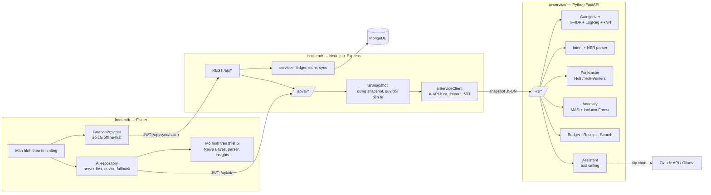
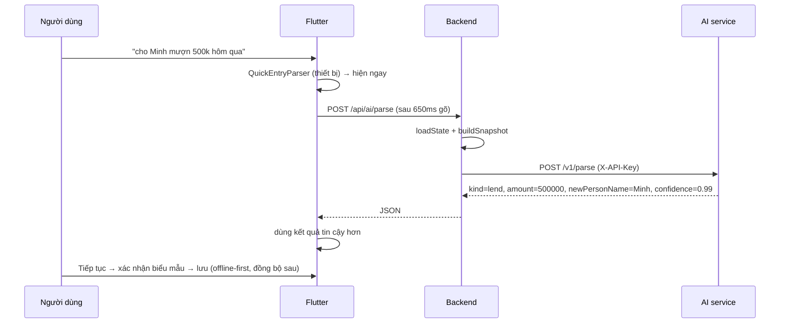
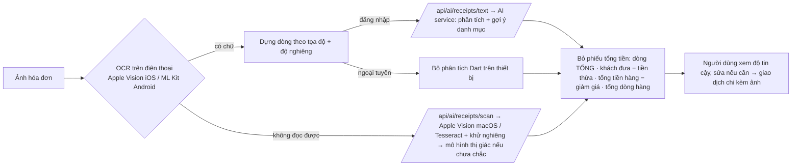

# Kiến trúc hệ thống

Hệ thống gồm **3 phần độc lập**, mỗi phần là một dự án riêng (phụ thuộc, kiểm thử, Dockerfile, README riêng)
và có thể triển khai trên máy chủ khác nhau.



## Nguyên tắc thiết kế

| Nguyên tắc | Hiện thực |
|---|---|
| Tách biệt trách nhiệm | Frontend chỉ hiển thị & lưu cục bộ; backend sở hữu dữ liệu và xác thực; AI service chỉ tính toán |
| AI service không trạng thái | Mọi yêu cầu kèm snapshot dữ liệu → nhân bản ngang dễ dàng, không phải đồng bộ dữ liệu người dùng |
| Phòng thủ nhiều lớp | Người dùng không gọi thẳng AI service; backend xác thực JWT, giới hạn tần suất, gửi khóa dịch vụ |
| Suy giảm mềm (graceful degradation) | AI service sập → backend trả 503 `AI_UNAVAILABLE` / trợ lý luật; app → mô hình trên thiết bị |
| Con người quyết định | LLM chỉ *đề xuất* (`propose_transaction`, `propose_budget`), người dùng bấm xác nhận |
| Quyền riêng tư | Snapshot không chứa email/mật khẩu; có thể chạy LLM cục bộ bằng Ollama |

## Luồng "nhập nhanh"



## Cấu trúc thư mục

```
Android-NHOM3/
├── frontend/      Flutter (Android, iOS, Web)        → frontend/README.md
├── backend/       Node.js + Express + MongoDB        → backend/README.md, backend/docs/openapi.yaml
├── ai-service/    Python + FastAPI + scikit-learn    → ai-service/README.md, ai-service/MODEL_CARD.md
├── docs/          Kiến trúc, báo cáo môn học
├── tool/          Kịch bản kiểm tra trên macOS
├── docker-compose.yml · Makefile · .github/workflows/ci.yml
```

## Luồng "quét hóa đơn" (OCR)



Đánh giá trên 100 ảnh hóa đơn tổng hợp chưa dùng để chỉnh: tổng tiền đúng 98% (Tesseract), 100% (Apple Vision).
