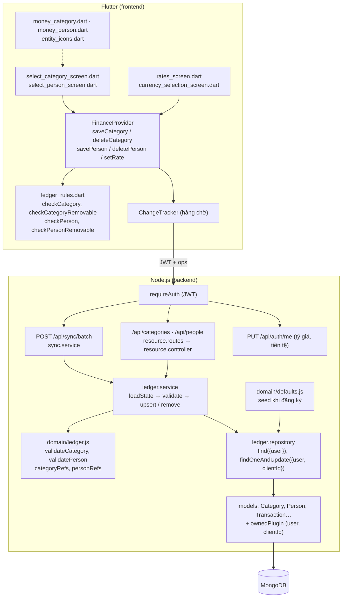
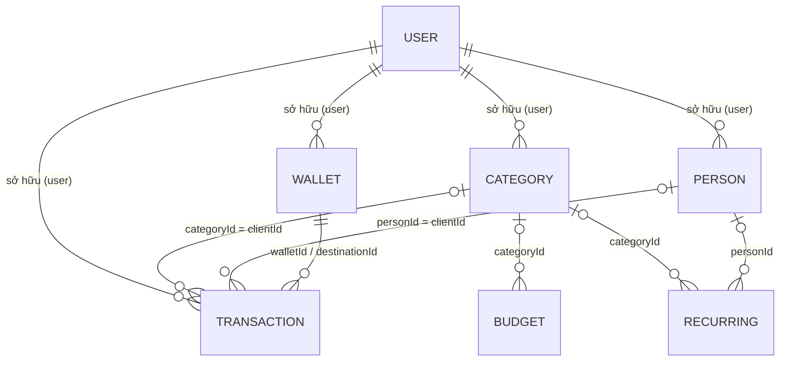

# Báo cáo khảo sát Module 1 – Danh mục, đối tượng, cấu hình

Dự án: Wisely – Quản lý chi tiêu cá nhân (Nhóm 03). Repository `Duzcc/LTD--FINANCIAL-APP`, nhánh `main`, commit `317c9da` (27/11/2026).
Giai đoạn: chỉ khảo sát, chưa sửa code. Mọi nhận định bên dưới đều dẫn tới tệp và dòng cụ thể để nhóm kiểm tra lại.

---

## 0. Tóm tắt nhanh

1. **Cơ sở dữ liệu là MongoDB (Mongoose), không phải CSDL quan hệ.** Quan hệ giữa Category, Person và Transaction là "tham chiếu mềm" bằng chuỗi `clientId`, được kiểm tra ở tầng nghiệp vụ (`backend/src/domain/ledger.js`), không có khóa ngoại thật.
2. **Module 1 phía backend đã chạy được gần đủ:** CRUD `/categories`, `/people`, danh mục mặc định khi đăng ký, chặn xóa khi đang dùng (409), chặn đổi loại thu/chi khi đã dùng (409), chặn trùng tên danh mục (409), cô lập dữ liệu theo người dùng qua `ownedPlugin`.
3. **App Flutter không gọi `/categories` hay `/people` trực tiếp.** App lưu trên máy trước, rồi gửi hàng chờ qua `POST /api/sync/batch` (`entity: "categories" | "people"`). REST CRUD chủ yếu dùng cho Postman, test và tài liệu.
4. **Có 3 lỗi đáng sửa trước khi demo:** (a) sửa tên danh mục mặc định trên app làm mất cờ `isDefault`; (b) tên danh mục quá 60 ký tự hoặc tên đối tượng quá 80 ký tự làm kẹt hàng chờ đồng bộ; (c) đối tượng chưa chặn trùng tên, chưa giới hạn nhóm.
5. **Việc được giao trong `docs/PHAN_CONG.md` có một phần đã có sẵn:** test "xóa đối tượng đang có giao dịch trả 409" đã nằm ở `backend/test/api.test.js:291`. Nên viết test mới cho những ca chưa ai kiểm (mục 10).
6. **Cần thống nhất với nhóm:** quy tắc BR10–BR13 và ca ngoại lệ NE-06 được nhắc trong `PHAN_CONG.md` nhưng **chưa được định nghĩa ở đâu trong repo** (kể cả tệp báo cáo `.docx`). Từ điển dữ liệu trong báo cáo cũng lệch với code.

---

## 1. Cấu trúc tổng thể repository

| Thư mục | Công nghệ | Vai trò |
|---|---|---|
| `frontend/` | Flutter 3, Dart ≥3.0, Provider | App Android/iOS/Web, lưu offline bằng SharedPreferences, đồng bộ khi đăng nhập |
| `backend/` | Node.js 22, Express 4, Mongoose 8 | REST API, xác thực JWT, sở hữu dữ liệu, kiểm tra nghiệp vụ |
| `ai-service/` | Python 3.11+, FastAPI, scikit-learn | Gợi ý danh mục, phân tích câu, dự báo; chỉ backend được gọi |
| `docs/` | | `PHAN_CONG.md`, `architecture.md`, báo cáo `.docx` |
| `tool/` | shell, mjs | Script kiểm thử trên macOS và máy ảo |
| `.github/` | | `CODEOWNERS`, mẫu PR, CI (`workflows/ci.yml`) |

**Cài đặt và chạy (theo `README.md`)**

```bash
# backend (cổng 3000)
cd backend && npm install && cp .env.example .env && npm run dev   # hoặc npm run dev:mem nếu chưa có MongoDB
# app
cd frontend && flutter pub get && flutter run
# kiểm thử
cd backend && npm test
cd frontend && flutter analyze && flutter test
```

Quy trình đóng góp (`CONTRIBUTING.md`, `PHAN_CONG.md`): tạo nhánh `feature/<tên>`, mỗi commit một thay đổi, tiêu đề tiếng Việt; trước PR chạy `npm run format && npm test` (backend) hoặc `dart format … && flutter analyze && flutter test` (frontend).

**Dependency chính**

| Phía | Gói | Dùng cho |
|---|---|---|
| Backend | `express`, `mongoose`, `jsonwebtoken`, `bcryptjs`, `helmet`, `cors`, `express-rate-limit`, `morgan`, `nodemailer`, `dotenv` | API, CSDL, xác thực, bảo mật |
| Backend (dev) | `mongodb-memory-server`, `supertest`, `eslint`, `prettier` | Test với MongoDB nhúng, gọi API trong test, kiểm tra định dạng |
| Frontend | `provider`, `http`, `shared_preferences`, `intl`, `fl_chart`, `flutter_local_notifications`, `image_picker`, `share_plus`, `archive`, `speech_to_text`, `qr_flutter` | Trạng thái, gọi API, lưu máy, định dạng tiền, biểu đồ |
| Frontend (dev) | `flutter_test`, `integration_test`, `flutter_lints` | Test và lint |

---

## 2. Sơ đồ kiến trúc module

### 2.1. Luồng dữ liệu của Module 1



Phần in đậm thuộc Module 1: các màn hình và entity trong khối Flutter (trừ `FinanceProvider`, `ledger_rules.dart`, `ChangeTracker`), `domain/defaults.js`, các model `Category`, `Person`, `plugin.js`, `index.js`, `scripts/`. Các khối còn lại thuộc thành viên khác, xem mục 13.

### 2.2. Quan hệ Category – Person – Transaction (theo code thật)



Điểm chính:
- Giao dịch trỏ tới danh mục và đối tượng bằng **`clientId` dạng chuỗi** (ví dụ `"food"`, `"binh"`), không phải `ObjectId`.
- Tham chiếu luôn được hiểu **trong phạm vi một người dùng**: `loadState(userId)` chỉ nạp dữ liệu của người đó, nên không thể trỏ sang danh mục của người khác.
- Khi nào giao dịch cần danh mục, đối tượng (`backend/src/domain/ledger.js:169-197`):

| Loại giao dịch (`kind`) | `categoryId` | `personId` |
|---|---|---|
| `expense`, `interestExpense` | **Bắt buộc**, phải là danh mục chi (`income = false`) | Tùy chọn (`interestExpense` bắt buộc vì là vay/nợ) |
| `income`, `interestIncome` | **Bắt buộc**, phải là danh mục thu (`income = true`) | Tùy chọn (`interestIncome` bắt buộc) |
| `lend`, `borrow`, `collect`, `repay` | Bị đặt về `null` | **Bắt buộc** và phải tồn tại |
| `transfer` | Bị đặt về `null` | Tùy chọn, ít dùng |

---

## 3. Danh sách file Module 1 và chức năng

Cột "Chủ sở hữu" lấy theo `.github/CODEOWNERS` (hiện mọi khối đều ghi `@Duzcc`, tên người lấy theo chú thích trong tệp).

### 3.1. Frontend

| Tệp | Dòng | Chức năng | Chủ sở hữu |
|---|---|---|---|
| `features/categories/presentation/screens/select_category_screen.dart` | 134 | Chọn danh mục khi nhập giao dịch; chế độ `manage: true` để thêm, sửa, xóa, tìm; chọn 1 trong 24 biểu tượng; đếm số giao dịch mỗi danh mục | Hiếu (M1) |
| `features/categories/presentation/screens/select_person_screen.dart` | 88 | Chọn, thêm, sửa, xóa đối tượng; nhóm theo 3 nhóm cố định "Cá nhân", "Bạn bè & Đồng nghiệp", "Cửa hàng & Dịch vụ" | Hiếu (M1) |
| `features/settings/presentation/screens/rates_screen.dart` | 54 | Sửa tỷ giá quy đổi sang VND; khôi phục mặc định; hiện tổng tài sản quy đổi | Hiếu (M1) |
| `features/wallets/presentation/screens/currency_selection_screen.dart` | 40 | Danh sách 6 tiền tệ (VND, USD, EUR, GBP, JPY, CNY), tìm kiếm, trả mã tiền tệ được chọn | Hiếu (M1) |
| `features/finance/domain/entities/money_category.dart` | 11 | Entity `MoneyCategory(id, name, income, symbol)`, `toJson`/`fromJson` | Hiếu (M1) |
| `features/finance/domain/entities/money_person.dart` | 6 | Entity `MoneyPerson(id, name, group)` | Hiếu (M1) |
| `features/finance/presentation/widgets/entity_icons.dart` | 55 | 24 biểu tượng danh mục, 12 biểu tượng ví; extension `.icon` | Hiếu (M1) |

Nơi gọi các màn hình này (không thuộc M1): `app_drawer.dart:70`, `account_screen.dart:59-83`, `add_transaction_screen.dart:338, 446`, `recurring_screen.dart:239, 251`, `budgets_screen.dart:70`, `create_wallet_screen.dart:157`, `home_screen.dart:80`.

### 3.2. Backend

| Tệp | Dòng | Chức năng | Chủ sở hữu |
|---|---|---|---|
| `src/models/Category.js` | 11 | Schema `name` (≤60), `income` (bắt buộc), `symbol`, `isDefault` + `ownedPlugin` | Hiếu (M1) |
| `src/models/Person.js` | 9 | Schema `name` (≤80), `group` (mặc định "Cá nhân", ≤60) + `ownedPlugin` | Hiếu (M1) |
| `src/models/plugin.js` | 23 | `ownedPlugin`: thêm `user`, `clientId`, chỉ mục duy nhất `(user, clientId)`, `timestamps`, ẩn trường nội bộ khi trả JSON | Hiếu (M1) |
| `src/models/index.js` | 13 | Gom 11 model để các tầng khác `require('../models')` | Hiếu (M1) |
| `src/domain/defaults.js` | 17 | Ví "Tiền mặt", 11 danh mục mặc định (7 chi, 4 thu), đối tượng "Bản thân" | Hiếu (M1) |
| `scripts/migrate-db.js` | 52 | Chép toàn bộ dữ liệu từ MongoDB nguồn (`SOURCE_URI`) sang đích (`MONGODB_URI`), rồi tạo chỉ mục; chạy bằng `npm run db:migrate` | Hiếu (M1) |

### 3.3. Tài liệu và kiểm thử (Module 1 cần sửa nhưng chủ sở hữu là người khác)

| Tệp | Hiện trạng | Chủ sở hữu theo CODEOWNERS |
|---|---|---|
| `backend/docs/openapi.yaml` | Chỉ có một đường dẫn chung `/api/{resource}`, chưa có schema Category, Person | **Dũng** |
| `backend/test/extra.test.js` | 5 test, chỉ 1 dòng liên quan danh mục (`DELETE /categories/house` → 409) | **Hải** |

---

## 4. Cơ chế `ownedPlugin` và quyền sở hữu dữ liệu

### 4.1. Nội dung plugin (`backend/src/models/plugin.js`)

| Thành phần | Giá trị | Ý nghĩa |
|---|---|---|
| `user` | `ObjectId`, `ref: 'User'`, `required`, `index` | Bản ghi thuộc về ai |
| `clientId` | `String`, `required`, mặc định là một ObjectId mới dạng hex | Mã bản ghi do app tạo (để làm việc offline), duy nhất trong phạm vi một người dùng |
| Chỉ mục | `{ user: 1, clientId: 1 }`, `unique` | Hai người dùng có thể cùng có danh mục `"food"` mà không đụng nhau |
| `timestamps` | `createdAt`, `updatedAt` | Sắp xếp danh sách theo thời gian tạo |
| `toJSON` | `id = clientId`; xóa `_id`, `clientId`, `user`, `createdAt`, `updatedAt`, `__v` | API không bao giờ lộ `_id` hay `user` |

Plugin được dùng cho 6 model nghiệp vụ: `Wallet`, `Category`, `Person`, `Transaction`, `Budget`, `Recurring`. `PaymentRequest`, `BankEvent` tự khai báo `user` riêng; `User`, `RefreshToken`, `OtpChallenge` không dùng plugin.

### 4.2. Cách xác định bản ghi thuộc về ai

1. `requireAuth` (`middleware/auth.js`) đọc `Authorization: Bearer <JWT>`, `session.service.authenticate` kiểm tra chữ ký, `tokenVersion` (`v`) và phiên thiết bị (`sid`), rồi gán `req.user`.
2. Controller chỉ truyền `req.user._id` xuống service (`resource.controller.js`). **Không có chỗ nào lấy `user` từ body hay query.**
3. `ledger.service` gọi `loadState(userId)` → `ledger.repository.loadState` chạy `Model.find({ user })` cho 6 bảng.
4. Tìm bản ghi theo `id` bằng `L.byId(state[key], id)` trên dữ liệu đã lọc theo người dùng.

### 4.3. Cách truy vấn và cập nhật theo quyền sở hữu

| Thao tác | Câu lệnh MongoDB | Tệp |
|---|---|---|
| Đọc | `find({ user }).sort({ createdAt: 1 })` | `ledger.repository.js:15` |
| Tạo / sửa | `findOneAndUpdate({ user, clientId: id }, { $set: fields, $setOnInsert: { user, clientId: id } }, { upsert: true, runValidators: true })` | `ledger.repository.js:19-25` |
| Xóa | `deleteOne({ user, clientId: id })` | `ledger.repository.js:29` |
| Tạo dữ liệu mặc định | `insertMany(categories.map(c => ({ ...c, user })))` | `ledger.repository.js:38-43` |
| Xóa tài khoản | `deleteMany({ user })` trên 10 model | `user.repository.js:34-36` |

Kiểm tra mã bản ghi: `checkId` chỉ nhận `^[A-Za-z0-9_-]{1,64}$` (`ledger.service.js:28`), chặn ký tự lạ và chèn toán tử MongoDB qua `id`.

### 4.4. Cách ngăn người dùng truy cập dữ liệu của người khác

| Tình huống | Kết quả | Lý do |
|---|---|---|
| `GET/DELETE /categories/<id của người khác>` | **404** `NOT_FOUND` | `state` chỉ chứa dữ liệu của mình nên không tìm thấy. Trả 404 thay vì 403 để không tiết lộ bản ghi có tồn tại |
| `PUT /categories/<id của người khác>` | **201**, tạo bản ghi mới **của mình** cùng `clientId` | Khóa duy nhất là `(user, clientId)` nên không ghi đè dữ liệu người khác |
| Giao dịch trỏ `categoryId` của người khác | **400** "Chọn danh mục phù hợp với giao dịch." | Kiểm tra tồn tại trên `state` của mình |
| Gửi `user` trong body | Bị bỏ qua | Validator chỉ chép các trường được phép |
| API trả về | Không có `user`, `_id` | `toJSON` của plugin |

Test đang có: `api.test.js:399` ("Dữ liệu tách biệt giữa người dùng") chỉ kiểm danh sách giao dịch và ví của người thứ hai. **Chưa có test** cho `GET/PUT/DELETE` danh mục, đối tượng theo id của người khác.

**Quy tắc đã có, nên giữ nguyên khi viết code mới:** luôn lấy `userId` từ `req.user._id`; mọi truy vấn đều có điều kiện `user`; trả 404 khi không phải của mình; `id` công khai là `clientId`.

---

## 5. Xác thực và phân quyền (phần liên quan Module 1)

- Toàn bộ `/api/categories`, `/api/people` (và 4 tài nguyên khác) được gắn `requireAuth` ở `routes/index.js:7`. Thiếu hoặc sai token → **401** `UNAUTHORIZED`.
- Access token JWT gồm `sub` (id người dùng), `v` (phiên bản token, tăng khi đổi mật khẩu hoặc đăng xuất mọi máy), `sid` (phiên thiết bị). Refresh token xoay vòng, chỉ dùng một lần.
- Không có phân quyền theo vai trò (admin, user). Quyền duy nhất là "chủ sở hữu dữ liệu".
- Không có giới hạn tần suất cho `/categories`, `/people` (rate limit chỉ áp cho `/auth`, `/ai`, webhook).

---

## 6. Xử lý lỗi và HTTP status code

Mọi lỗi trả về dạng `{ "error": { "code": "...", "message": "..." } }` (`middleware/error.js`). Lỗi nghiệp vụ được tạo bằng `utils/errors.js`.

| Status | `code` | Khi nào xảy ra ở Module 1 | Nguồn |
|---|---|---|---|
| 200 | | `GET` danh sách, chi tiết; `PUT` sửa bản ghi có sẵn | controller |
| 201 | | `POST` tạo mới; `PUT` với id chưa có (upsert) | controller |
| 204 | | `DELETE` thành công | controller |
| 400 | `VALIDATION_ERROR` | Tên rỗng; `id` sai định dạng; `POST` với `id` đã tồn tại ("hãy dùng PUT") | `ledger.js:122, 142`; `ledger.service.js:28, 141` |
| 400 | `VALIDATION_ERROR` "Dữ liệu không hợp lệ." | Lỗi Mongoose: tên danh mục > 60 hoặc tên đối tượng > 80 ký tự | `error.js:16` |
| 400 | `BAD_JSON` | Body không phải JSON | `error.js:13` |
| 401 | `UNAUTHORIZED` | Thiếu, sai hoặc hết hạn token | `middleware/auth.js` |
| 404 | `NOT_FOUND` | Id không có hoặc thuộc người khác | `ledger.service.js:59` |
| 409 | `DUPLICATE_NAME` | Trùng tên danh mục cùng loại (không phân biệt hoa thường) | `ledger.js:127` |
| 409 | `HAS_REFERENCES` | Xóa danh mục đang dùng; xóa đối tượng đang có giao dịch | `ledger.service.js:65-66` |
| 409 | `CONFLICT` | Đổi loại thu/chi của danh mục đã dùng | `ledger.js:131` |
| 409 | `DUPLICATE` | Trùng chỉ mục `(user, clientId)` ở tầng MongoDB (hiếm) | `error.js:19` |
| 500 | `SERVER_ERROR` | Lỗi khác | `error.js:21` |

Với `POST /sync/batch`: lỗi nghiệp vụ (`ApiError`) trả status của lỗi kèm `{ applied, failedIndex, error }`, để app biết đã lưu được bao nhiêu thao tác. Lỗi không phải `ApiError` (ví dụ lỗi Mongoose) **không** có `applied` (xem lỗi L2 ở mục 12).

---

## 7. API đang triển khai cho Module 1

Tất cả cần `Authorization: Bearer <token>`. Định nghĩa ở `routes/resource.routes.js`, `controllers/resource.controller.js`, `services/ledger.service.js`.

| Phương thức | Đường dẫn | Mô tả | Body / Query | Trả về |
|---|---|---|---|---|
| GET | `/api/categories` | Danh sách danh mục | `?income=true\|false` (lọc thu/chi) | `200 { items: [Category] }` |
| GET | `/api/categories/:id` | Chi tiết | | `200 Category` / `404` |
| POST | `/api/categories` | Tạo | `{ id?, name, income, symbol?, isDefault? }` | `201` / `400` / `409` |
| PUT | `/api/categories/:id` | Sửa, hoặc tạo nếu chưa có | như POST | `200` hoặc `201` / `400` / `409` |
| DELETE | `/api/categories/:id` | Xóa | | `204` / `404` / `409` |
| GET | `/api/people` | Danh sách đối tượng | không có bộ lọc | `200 { items: [Person] }` |
| GET | `/api/people/:id` | Chi tiết | | `200` / `404` |
| POST | `/api/people` | Tạo | `{ id?, name, group? }` | `201` / `400` |
| PUT | `/api/people/:id` | Sửa hoặc tạo | như POST | `200` / `201` / `400` |
| DELETE | `/api/people/:id` | Xóa | | `204` / `404` / `409` |
| POST | `/api/sync/batch` | App dùng đường này | `ops: [{ entity: "categories"\|"people", action: "upsert"\|"delete", id, data }]` | `200 { applied }` hoặc lỗi kèm `applied` |
| GET | `/api/sync` | Ảnh chụp dữ liệu, có `categories`, `people` | | `200` |
| PUT | `/api/auth/me` | Lưu `currency` và `rates` (tỷ giá) | `{ currency?, rates?: { USD: 25400, … } }` | `200 { user }` |

Dữ liệu trả về:
```json
// Category
{ "id": "food", "name": "Ăn uống", "income": false, "symbol": 0, "isDefault": true }
// Person
{ "id": "self", "name": "Bản thân", "group": "Cá nhân" }
```

Lưu ý: `?cascade=true` chỉ có tác dụng với ví; danh mục và đối tượng không có xóa kèm.

---

## 8. Quy tắc nghiệp vụ liên quan

Mã BR10–BR13 được nhắc trong `PHAN_CONG.md` nhưng chưa định nghĩa ở đâu. Bảng dưới đánh số **tạm** theo ba ràng buộc được giao ở `PHAN_CONG.md` mục 2, cần nhóm xác nhận trước khi đưa vào báo cáo.

| Mã đề xuất | Quy tắc | Backend | Frontend | Test hiện có |
|---|---|---|---|---|
| BR10 | Không xóa danh mục đang được dùng (giao dịch, ngân sách hoặc giao dịch định kỳ) → 409 "Danh mục đang được sử dụng." | `ledger.js:135`, `ledger.service.js:64` | `ledger_rules.dart:125` | `api.test.js:325`, `extra.test.js` (`house`), `features_test.dart:38`, `finance_provider_test.dart:95` |
| BR11 | Không xóa đối tượng đang có giao dịch hoặc giao dịch định kỳ → 409 "Đối tượng đang có giao dịch." | `ledger.js:145`, `ledger.service.js:66` | `ledger_rules.dart:137` | `api.test.js:291` |
| BR12 | Không đổi loại thu/chi của danh mục đã được dùng → 409 | `ledger.js:130-131` | **Không có** (UI không cho đổi loại nên chưa cần) | **Chưa có** |
| BR13 | Tên danh mục không trùng trong cùng loại, không phân biệt hoa thường → 409 `DUPLICATE_NAME` | `ledger.js:124-127` | `ledger_rules.dart:120` | `api.test.js:298` |

Quy tắc khác đang có trong code:

| Quy tắc | Vị trí |
|---|---|
| Tên danh mục, đối tượng bắt buộc (sau khi bỏ khoảng trắng) | `ledger.js:122, 142`; `ledger_rules.dart:119, 134` |
| Danh mục của giao dịch phải đúng loại thu/chi | `ledger.js:193-194` |
| Giao dịch vay/nợ phải có đối tượng; đối tượng phải tồn tại | `ledger.js:196-197` |
| `symbol` ngoài khoảng 0–23 bị **lặng lẽ** đặt về 0 (không báo lỗi) | `ledger.js:123` |
| Đăng ký tài khoản tạo sẵn 1 ví, 11 danh mục, 1 đối tượng (bỏ qua nếu `seedDefaults: false`) | `auth.service.js:25-27`, `defaults.js` |
| Tiền tệ hỗ trợ: VND, USD, EUR, GBP, JPY, CNY | `constants.js:17`, `currency_selection_screen.dart` |
| Tỷ giá phải là số > 0; mã tiền tệ lạ bị bỏ | `auth.validator.js:63-69`, `finance_provider.dart:289` |

---

## 9. Kiểm thử hiện có

| Bộ test | Cách chạy | Ghi chú |
|---|---|---|
| Backend | `cd backend && npm test` (`node --test --test-concurrency=1 test/*.test.js`) | Dùng `mongodb-memory-server` (tự tải MongoDB) hoặc `TEST_MONGODB_URI`. Mỗi tệp test dùng một CSDL riêng, đăng ký người dùng qua OTP (`helpers/auth.js`) |
| Frontend | `cd frontend && flutter test` | Test `FinanceProvider` không cần backend; `helpers/fake_backend.dart` giả backend |
| Giao diện | `flutter drive … integration_test/report_flows_test.dart` | Cần máy ảo và backend chạy |
| CI | `.github/workflows/ci.yml` | Backend dùng service `mongo:7`, chạy `npm run lint` rồi `npm test` |

Trong lần khảo sát này em **không chạy được** `npm test`: máy cloud bị chặn tải bản MongoDB của `mongodb-memory-server`. Trên máy nhóm hoặc CI thì chạy bình thường. Kết luận về test bên dưới là đọc code, không phải kết quả chạy.

Ca kiểm thử Module 1 đã có và còn thiếu:

| Ca | Đã có? |
|---|---|
| Tạo danh mục 201, trùng tên 409 | Có (`api.test.js:296-298`) |
| Lọc `?income=false` trả 7 danh mục chi mặc định | Có (`api.test.js:101`) |
| Xóa danh mục đang dùng 409, chưa dùng 204 | Có (`api.test.js:325-327`) |
| Tạo đối tượng 201; xóa đối tượng có giao dịch 409 | Có (`api.test.js:231, 291`) |
| Đổi loại thu/chi của danh mục đã dùng 409 | **Chưa** |
| Xóa đối tượng chỉ được dùng trong giao dịch định kỳ 409 | **Chưa** |
| Xóa đối tượng không có giao dịch 204 | **Chưa** |
| `GET/PUT/DELETE` danh mục, đối tượng của người khác (404, không ghi đè) | **Chưa** |
| Xóa danh mục qua `/sync/batch` trả 409 kèm `applied` | **Chưa** |
| Tên quá dài | **Chưa** |

---

## 10. Tài liệu OpenAPI hiện có (`backend/docs/openapi.yaml`, 176 dòng)

- OpenAPI 3.0.3, có `securitySchemes.bearer`, schema `Error`, response `Error`, `Session`, `AiUnavailable`. Được phục vụ tại `GET /api/openapi.yaml`.
- Tài nguyên được gộp thành `/api/{resource}` và `/api/{resource}/{id}` với `enum` 6 tài nguyên.

Phần còn thiếu hoặc chưa đúng với code (phần Module 1):

| # | Vấn đề | Code thực tế |
|---|---|---|
| O1 | Không có schema `Category`, `CategoryInput`, `Person`, `PersonInput` | xem mục 7 |
| O2 | `DELETE` ghi trả `200` | Trả `204` |
| O3 | Không ghi `409` (`DUPLICATE_NAME`, `HAS_REFERENCES`, `CONFLICT`), `401`, `404` cho danh mục, đối tượng | xem mục 6 |
| O4 | Không có tham số `?income` cho danh mục | `ledger.service.js:116` |
| O5 | `PUT` không ghi "tạo mới nếu chưa có → 201" | `resource.controller.js:9-11` |
| O6 | Thiếu `/auth/verify-otp`, `/auth/resend-otp` (việc của Dũng) | |

---

## 11. Những thành phần đã hoàn thành

1. Model `Category`, `Person` với `ownedPlugin`, chỉ mục duy nhất `(user, clientId)`.
2. CRUD đủ 5 thao tác cho `/categories`, `/people`; lọc danh mục theo thu/chi.
3. Ba ràng buộc chính trong `PHAN_CONG.md` đã có ở cả backend (BR10, BR11, BR12) và frontend (BR10, BR11); chặn trùng tên danh mục ở cả hai phía.
4. Danh mục mặc định khi đăng ký, khớp giữa `defaults.js` và `FinanceProvider._defaultCategories`.
5. Cô lập dữ liệu theo người dùng; 404 khi truy cập bản ghi của người khác; xóa tài khoản xóa sạch dữ liệu.
6. Màn hình quản lý danh mục (tìm, thêm, sửa, xóa, chọn biểu tượng, chuyển Chi/Thu), đối tượng (3 nhóm), tiền tệ, tỷ giá.
7. Đồng bộ offline: thêm, sửa, xóa trên máy rồi đẩy lên server theo đúng thứ tự (danh mục, đối tượng được upsert trước giao dịch và xóa sau giao dịch, `change_tracker.dart:22-24`).
8. Script chuyển CSDL `migrate-db.js` có kiểm tra nguồn trùng đích, che mật khẩu khi in log.

---

## 12. Những thành phần còn thiếu hoặc chưa đúng

Mức độ: **Cao** = sai dữ liệu hoặc kẹt đồng bộ; **TB** = thiếu ràng buộc, lệch tài liệu; **Thấp** = nên cải thiện.

| # | Mức | Vấn đề | Bằng chứng | Hậu quả |
|---|---|---|---|---|
| L1 | Cao | Sửa danh mục mặc định trên app làm mất `isDefault` | `MoneyCategory.toJson` không có `isDefault` (`money_category.dart:8`); server đặt `isDefault: bool(input.isDefault)` = `false` (`ledger.js:120`) | Đổi tên "Ăn uống" xong thì server coi là danh mục tự tạo. Ngược lại, client có thể tự gửi `isDefault: true` cho danh mục bất kỳ |
| L2 | Cao | Tên danh mục > 60 hoặc tên đối tượng > 80 ký tự làm kẹt hàng chờ | Validator không kiểm độ dài; Mongoose báo `ValidationError`; `sync.service.js:28` chỉ bắt `ApiError` nên phản hồi không có `applied`; app gặp `applied is! int` thì giữ nguyên hàng chờ (`finance_provider.dart:757`); ô nhập trên app không có `maxLength` | Lần đồng bộ nào cũng hỏng ở cùng thao tác đó, các thay đổi phía sau không lên được server. Kết luận này rút ra từ đọc code, chưa chạy thử |
| L3 | TB | Đối tượng chưa chặn trùng tên, chưa kiểm `group` | `validatePerson` (`ledger.js:140-144`) | Có thể có hai "Minh"; API nhận `group` bất kỳ trong khi app chỉ có 3 nhóm |
| L4 | TB | Không bảo vệ danh mục mặc định, đối tượng "Bản thân" | `remove` không xét `isDefault` hay `id === 'self'` | Xóa hết danh mục thu hoặc chi thì SePay báo lỗi "Chưa có danh mục thu nhập" (`sepay.service.js:31, 58`). Cần nhóm quyết định đây là lỗi hay là tính năng |
| L5 | TB | `symbol` sai bị đổi về 0 mà không báo | `ledger.js:123` | Khác cách làm của ví (ví báo 400). Chỉ cần ghi rõ trong tài liệu, hoặc thống nhất một kiểu |
| L6 | TB | Từ điển dữ liệu trong báo cáo `.docx` (Bảng 9–11) lệch code | Báo cáo: `LoaiDanhMuc` = "MacDinh/KhongMacDinh", PK `ObjectId`, `Decimal128`, `MaDanhMuc`/`MaDoiTuong` bắt buộc. Code: `income` (Boolean) + `isDefault` + `symbol`, khóa `(user, clientId)` chuỗi, `Number`, `categoryId`/`personId` có thể `null`; `DoiTuong` thiếu `group` | Giảng viên hỏi ERD sẽ thấy không khớp |
| L7 | TB | BR10–BR13, NE-06 chưa được định nghĩa | `grep` toàn repo chỉ thấy trong `PHAN_CONG.md` | Không thể "giải thích quy tắc BR10–BR13" như được giao |
| L8 | TB | OpenAPI thiếu phần danh mục, đối tượng | mục 10 | |
| L9 | TB | `MoneyCategory` thiếu `isDefault`; `MoneyPerson.fromJson` không chuẩn hóa `group` rỗng | `money_category.dart`, `money_person.dart` | Gắn với L1 |
| L10 | Thấp | `POST` với `id` đã tồn tại trả 400 thay vì 409 | `ledger.service.js:141` | Chỉ ghi nhận; tệp này thuộc Module 2, không tự sửa |
| L11 | Thấp | Chỉ mục `user` đơn bị thừa vì chỉ mục ghép `(user, clientId)` đã phủ | `plugin.js:5, 8` | Tốn thêm dung lượng, không sai |
| L12 | Thấp | Kiểm tra trùng tên chỉ ở tầng ứng dụng; hai request cùng lúc có thể tạo hai danh mục cùng tên | `ledger.js:124-127` | Hiếm gặp ở ứng dụng cá nhân |
| L13 | Thấp | Server không có tỷ giá mặc định; người dùng chưa từng mở Cài đặt thì `rates` trên server trống | `User.rates default: undefined`; `snapshot.js:6-7` trả `null` cho tiền ngoại tệ | AI bỏ qua ví ngoại tệ. Thuộc phần snapshot của Module 3, cần trao đổi |
| L14 | Thấp | `migrate-db.js` không có tùy chọn chạy thử, ghi đè theo `_id` | `migrate-db.js:33` | Cần cảnh báo trong README trước khi chạy trên Atlas thật |

---

## 13. Những phần cần phối hợp với thành viên khác

| Việc | Tệp | Người phụ trách | Nội dung cần trao đổi |
|---|---|---|---|
| Bổ sung OpenAPI `/categories`, `/people` | `backend/docs/openapi.yaml` | **Dũng** (CODEOWNERS) | Dũng cũng đang sửa phần `auth` trong cùng tệp → chia vùng sửa hoặc ghép một PR để tránh xung đột |
| Thêm test backend | `backend/test/extra.test.js` | **Hải** (CODEOWNERS, chủ trì kiểm thử) | Xin duyệt; thống nhất viết vào `extra.test.js` hay tách tệp `categories.test.js` |
| Sửa L2 (bắt lỗi validation trong sync) | `sync.service.js`, `ledger.js` | **Dũng** (sync), **Nhiệm** (`domain/ledger.js`) | Cách ít đụng nhất: thêm kiểm tra độ dài vào `validateCategory`, `validatePerson` để lỗi thành `ApiError` |
| Sửa L1, L3, L4 (validator) | `backend/src/domain/ledger.js` | **Nhiệm** (CODEOWNERS) | Hàm `validateCategory`, `validatePerson`, `categoryRefs`, `personRefs` nằm trong tệp của Module 3 |
| Kiểm tra phía app | `frontend/lib/features/finance/domain/ledger_rules.dart` | **Nhiệm** | `checkCategory`, `checkPerson` thuộc tệp của Module 3 |
| Danh mục mặc định, tỷ giá mặc định ở app | `finance_provider.dart` | **Đức (Trần Văn Đức)** | `_defaultCategories`, `defaultRates` phải khớp `defaults.js` |
| Tỷ giá trên server | `User.js`, `auth.validator.js`, `snapshot.js` | **Dũng**, **Nhiệm** | L13 |
| `POST` id trùng trả 400 | `ledger.service.js` | **Đức (Hoàng Anh Đức)** | L10, chỉ góp ý |
| Danh mục fallback của SePay | `sepay.service.js` | **Đức (Trần Văn Đức)** | Phụ thuộc `other_income`, `life`, tên có chữ "khác" |
| Bảng BR10–BR13, NE-06, từ điển dữ liệu | báo cáo `.docx` | Cả nhóm | Thống nhất mã quy tắc và cập nhật Bảng 9–11 theo code |

---

## 14. Danh sách việc nên làm, theo thứ tự ưu tiên

Lịch nhóm: 28–29/11 làm việc và slide, 30/11 ghép slide, 01/12 nộp. Thứ tự dưới đây xếp theo "ảnh hưởng tới điểm và demo", rồi tới "ít đụng tệp của người khác".

| # | Việc | Loại | Tệp | Cần ai duyệt | Ước lượng |
|---|---|---|---|---|---|
| 1 | Chốt với nhóm định nghĩa BR10–BR13, NE-06 (dùng bảng mục 8 làm bản nháp) | Tài liệu | `PHAN_CONG.md`, báo cáo | Cả nhóm | 30 phút |
| 2 | Viết test backend cho các ca còn thiếu (mục 9): đổi loại 409, đối tượng chỉ dùng ở định kỳ 409, xóa đối tượng trống 204, truy cập của người khác 404, xóa qua `/sync/batch` 409 có `applied` | Test | `extra.test.js` | Hải | 1–2 giờ |
| 3 | Bổ sung OpenAPI cho `/categories`, `/people` (O1–O5) | Tài liệu | `openapi.yaml` | Dũng | 1 giờ |
| 4 | Sửa L1: thêm `isDefault` vào `MoneyCategory`; server giữ `isDefault` cũ khi sửa và không cho client tự đặt | Code | `money_category.dart` (M1), `ledger.js` (M3) | Nhiệm | 1 giờ |
| 5 | Sửa L2: giới hạn độ dài tên ở validator (60/80 ký tự) và thêm `maxLength` ở ô nhập trên app | Code | `ledger.js` (M3), `select_category_screen.dart` (M1), `finance_ui.dart` | Nhiệm, Đức | 1 giờ |
| 6 | Cập nhật từ điển dữ liệu, ERD trong báo cáo mục 2.2 theo code (L6) | Báo cáo | `.docx` | | 1–2 giờ |
| 7 | Chuẩn bị luồng demo: thêm "Thưởng dự án" → dùng cho khoản thu → thử xóa báo "Danh mục đang được sử dụng" → thêm đối tượng "Minh" | Demo | | | 30 phút |
| 8 | Quyết định L3 (trùng tên đối tượng, kiểm `group`) và L4 (bảo vệ danh mục mặc định) | Thảo luận | `ledger.js` | Nhiệm | 30 phút |
| 9 | Ghi chú cách dùng `migrate-db.js` an toàn (L14) | Tài liệu | `backend/README.md` | Đức (Trần Văn Đức) | 15 phút |

### 14.1. So sánh phương án cho việc số 2 (test backend)

| Tiêu chí | A. Viết thêm vào `extra.test.js` (khuyến nghị) | B. Tách tệp mới `categories.test.js` | C. Chỉ làm đúng đề: 1 test "xóa đối tượng có giao dịch → 409" |
|---|---|---|---|
| Khớp phân công | Đúng tệp được giao | Lệch tệp, nhưng CODEOWNERS mặc định vẫn là Đức | Đúng tệp nhưng **trùng** `api.test.js:291` |
| Phải đụng tệp người khác | Có (Hải duyệt) | Không | Có |
| Giá trị khi vấn đáp | Cao: phủ BR12, cô lập dữ liệu, đồng bộ | Cao | Thấp |
| Thời gian chạy test | +1 lần đăng ký người dùng, dùng chung `before` | +1 CSDL, +1 lần khởi động MongoDB nhúng | Ít nhất |
| Rủi ro xung đột Git | Trung bình (Hải cũng sửa `test/`) | Thấp | Trung bình |

### 14.2. So sánh phương án cho việc số 3 (OpenAPI)

| Tiêu chí | A. Giữ `/api/{resource}` chung, thêm `oneOf` schema | B. Tách riêng `/api/categories`, `/api/people` (khuyến nghị) | C. Chỉ thêm schema vào `components`, không sửa paths |
|---|---|---|---|
| Đúng với code | Đúng (code dùng chung một router) | Đúng | Đúng một phần |
| Dễ đọc trên Swagger, Postman | Trung bình | Tốt: mỗi tài nguyên có body và lỗi riêng | Kém |
| Ghi được 409 riêng cho từng tài nguyên | Khó | Dễ | Không |
| Đụng phần của người khác | Có: đường chung cũng dùng cho ví, giao dịch, ngân sách | Ít: chỉ thêm khối mới | Ít |
| Công sức | Trung bình | Trung bình | Ít |

### 14.3. So sánh phương án cho việc số 4 (L1 – giữ cờ `isDefault`)

| Tiêu chí | A. Server giữ giá trị cũ, bỏ qua `isDefault` client gửi (khuyến nghị) | B. App gửi kèm `isDefault` | C. Bỏ hẳn trường `isDefault` |
|---|---|---|---|
| Sửa ở đâu | `ledger.js` (1 dòng) | `money_category.dart` + `ledger.js` | Model, `defaults.js`, báo cáo |
| Chống client giả cờ | Có | Không | Không cần |
| Ảnh hưởng dữ liệu cũ | Không sửa được bản ghi đã bị ghi `false` | Như A | Mất thông tin "mặc định" trong ERD |
| Phù hợp báo cáo (LoaiDanhMuc Mặc định/Không) | Có | Có | Không |

---

*Báo cáo được lập từ việc đọc mã nguồn tại commit `317c9da`. Chưa sửa tệp nào trong repository.*
